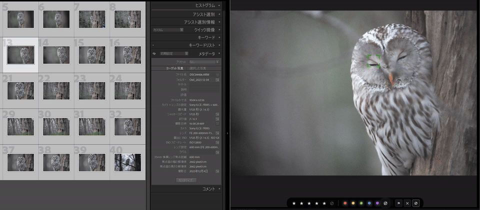
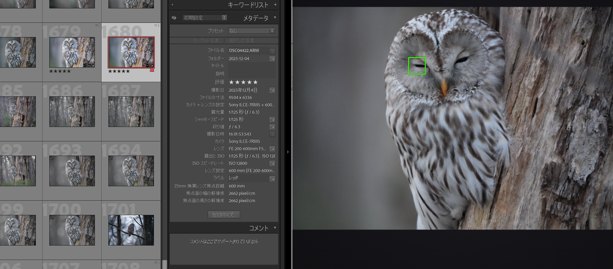

# Focus Visualizer

**See where your camera focused — right beside Lightroom Classic.**

Lightroom Classic の横に、カメラが記録した AF の位置を表示するビューアーです（Sony α / Canon EOS）。→ [日本語の説明](#日本語)

-blue)

*Select a photo in Lightroom Classic (left) — Focus Visualizer (right) shows the AF frame the camera recorded. Press `Space` to check it at 100%.*

---

## Why

Lightroom Classic doesn't show which AF point the camera used. To check focus, you zoom to 1:1 on every frame and wait for it to render.

Focus Visualizer reads the AF data that the camera recorded in the RAW file and shows it next to Lightroom. You can see at a glance whether the focus landed on the eye — and move on to the next shot.

## What it does

- **AF frame on every photo** — the AF position recorded by the camera (toggle with `F`).
- **Follows Lightroom** — select a photo in Lightroom and the viewer switches. `←` / `→` in the viewer moves Lightroom's selection too.
- **Jump to the focus point at 1:1** — `Space` zooms to 100%, centered on the AF point.
- **Cull without switching windows** — ratings (`1`–`5`), color labels and Pick / Reject set in the viewer are applied to Lightroom.
- **Focus info for Sony α** — AF area, subject recognition settings and Flexible Spot size.
- **Focus peaking** — highlights in-focus areas (`P`).
- **Lite Mode** — a small, always-on-top window that sits beside Lightroom.
- **Fast** — images and metadata are read straight from the RAW file, without waiting for Lightroom's previews. While you flick through photos quickly, a lighter image is shown first.
- **100% local** — no internet connection, no data collection. Your RAW files are only read, never changed.

## Supported

| | |
| :--- | :--- |
| **Cameras** | Sony α, Canon EOS R series (RAW files) |
| **Lightroom** | Lightroom Classic (v12.0 or later recommended) |
| **Windows** | Windows 10 / 11 (64-bit). Portable — no installation, all runtimes bundled |
| **Mac** | Apple Silicon, macOS 13 (Ventura) or later |

- Nikon, Fujifilm and other brands are not supported yet.
- Crops, rotations and other edits made in Lightroom are not shown in the viewer. This is by design: AF frames are drawn on the image as the camera recorded it.

## Getting started

1. Download the ZIP for your OS from **[Releases](https://github.com/muromix/FocusVisualizer/releases/latest)** and extract it.
2. In Lightroom Classic, open **[File] ＞ [Plug-in Manager]**, click **[Add]**, and select the `Focus_Visualizer.lrplugin` folder in the package.
3. Select a photo and choose **[Library] ＞ [Plug-in Extras] ＞ [Focus Visualizer]**.

On Mac, open the app once before step 2 (it is not notarized by Apple). Full steps: **[Installation Guide (English)](Walkthrough/INSTALLATION_GUIDE_EN.md)** / **[導入の手引き（日本語）](Walkthrough/INSTALLATION_GUIDE_JP.md)**

## FAQ

**Is it free?**
Yes, for personal use. See the [LICENSE](LICENSE).

**Does it change my photos?**
No. RAW files are only read. Ratings, labels and flags that you set in the viewer are written to your Lightroom catalog, the same as setting them in Lightroom.

**Does it send anything over the internet?**
No. Everything runs on your computer. Lightroom, the viewer and the analysis talk to each other only through `127.0.0.1` (localhost).

**Why does my Mac say the app can't be opened?**
The Mac version is not notarized by Apple yet. The [Installation Guide](Walkthrough/INSTALLATION_GUIDE_EN.md) shows how to open it the first time.

## Documentation

- **Specification**: [English](Walkthrough/SPECIFICATION_EN.md) / [日本語](Walkthrough/SPECIFICATION_JP.md) — features, keyboard shortcuts, quality modes
- **[UI Specification (Japanese)](Walkthrough/UI_SPECIFICATION.md)**
- **[EXIF Tags Guide (Japanese)](Walkthrough/EXIF_TAGS_GUIDE_JP.md)** — which maker-note tags are used
- **[Concept](Walkthrough/FOCUS_VISUALIZER_CONCEPT.md)** — the ideas behind the project

## Support the project

If Focus Visualizer saves you time, please consider supporting its development.

- **[BOOTH (Angie's Lab)](https://angieslab.booth.pm/)**
- **[Buy Me a Coffee](https://buymeacoffee.com/muromix)**

---

## 日本語

**Focus Visualizer** は、Lightroom Classic で選んだ写真を横に表示し、カメラが記録した AF の位置（緑の枠）を重ねるビューアーです。1 枚ずつ等倍に拡大しなくても、ピントが瞳に合っているかをすぐに確かめられます。

- **AF の枠を表示**: カメラが記録した AF の位置（`F` で表示・非表示）
- **Lightroom と連動**: Lightroom で写真を選ぶと切り替わり、ビューアーの `←` / `→` で Lightroom の選択も動きます
- **合った所を等倍で**: `Space` で、AF の位置を中心に 100% 表示
- **その場で選別**: ビューアーで付けたレーティング・カラーラベル・フラグは Lightroom に反映されます
- **Sony α のピント情報**: AF エリア・被写体認識の設定・Flexible Spot の大きさ
- **ピーキング**（`P`）・**Lite モード**（Lightroom の横に置ける小さな窓）
- **すべて手元で動作**: インターネットに接続せず、情報も集めません。RAW ファイルは読むだけで、書き換えません

**対応**: Sony α・Canon EOS R シリーズの RAW／Lightroom Classic（v12.0 以上を推奨）／Windows 10・11（64bit）／Mac（Apple シリコン、macOS 13 以上）

**はじめかた**: [Releases](https://github.com/muromix/FocusVisualizer/releases/latest) から ZIP をダウンロードし、[導入の手引き](Walkthrough/INSTALLATION_GUIDE_JP.md) に沿って Lightroom にプラグインを登録します。個人の利用は無料です。応援は [BOOTH](https://angieslab.booth.pm/) から。

---

## About this project

Focus Visualizer is developed by muromix, working together with AI partners. → **[The team behind Focus Visualizer](Walkthrough/TEAM.md)**

## License

Focus Visualizer is provided under a **Personal Use Only** license.

- **Free for personal, non-commercial use.**
- **Redistribution is prohibited.** Please download from official channels only.
- **Modification and commercial use are prohibited.**

See the full [LICENSE](LICENSE) for details.

*(c) 2026 MUROMIX. All rights reserved.*
