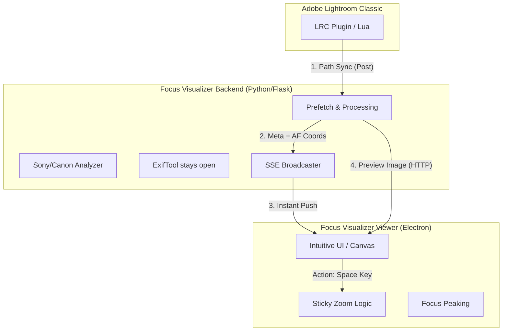

# Focus Visualizer: The Philosophy of Precision

## 🎯 1. Core Concept: "Focus on the Focus"

Focus Visualizer is not just a viewer; it is a **Decision-Making Engine** for professional photographers.

While Adobe Lightroom Classic is powerful for color and composition, determining the exact sharpness of a RAW file often requires multiple clicks and waiting for rendering. Our philosophy is to **visualize what is hidden** in the metadata—instantly.

---

## 💡 2. Why it matters

### The Problem
- **The Culling Bottleneck**: Reviewing 1,000+ photos after a shoot takes hours because checking focus requires zooming in manually for every single frame.
- **Hidden Metadata**: Cameras record exactly where they focused, but most post-processing software discards or hides this information.

### The Solution
- **Instant Visualization**: See the AF position recorded by your camera, overlaid on the image.
- **Real-Time Workflow**: Syncs with Lightroom. As you select photos in Lightroom, Focus Visualizer follows.

---

## 🚀 3. Key Pillars & Features

### I. High-Speed Review (The Engine)
- **Parallel Analysis Pipeline**: Utilizes a dual-track system. Metadata (AF frames/Camera info) is parsed via an **ExifTool Stay-Open Instance** for millisecond delivery, while a background thread extracts the preview simultaneously.
- **2-Step Delivery via SSE**: Metadata and AF coordinates are pushed to the viewer via Server-Sent Events as soon as they are parsed, and the preview image is loaded from the local server. AF frames can appear before the image finishes loading.
- **Prefetching**: Metadata for neighboring photos is loaded in advance to keep high-speed "flipbook" culling smooth.
- **Sticky Zoom (Logic-Driven)**: Not just a zoom; it calculates the precise normalized coordinates of the primary AF point to center the view instantly.

### II. Advanced Logistics (Analysis)
- **Multi-Brand Support**: Parsing for **Sony Alpha** and **Canon EOS R series** metadata.
- **Focus Peaking**: Contrast-detection overlay that highlights in-focus areas, with an adjustable threshold.

### III. Architected for Pros (Reliability)
- **100% Local & Private**: No cloud, no internet. Your data never leaves your machine.
- **SSE Real-time Sync**: The viewer receives updates from the backend instantly via Server-Sent Events.
- **Cross-Platform (Win/Mac)**:
  - **Windows**: Fully portable—no Python or Node.js installation required.
  - **Mac**: Native `.app` bundle for Apple Silicon Macs.
- **Native Path Support**: Includes "Mojibake Rescue" logic for Windows, so photos in folders with Japanese/Multi-byte names can be displayed.

---

## 🏗️ 4. Conceptual Architecture

---

## 📈 5. The Result
By using Focus Visualizer, the "Culling Phase" of photography is transformed from a chore into a high-speed, logical process. You can trust your eyes and the machine's precision simultaneously.

**Focus on the Focus. Capture the Soul.**

---
 
 

# Focus Visualizer: 精密さの哲学

## 🎯 1. コア・コンセプト：「合焦（フォーカス）に集中せよ」

Focus Visualizerは単なるビューアーではありません。プロフェッショナルなフォトグラファーのための**「意思決定エンジン」**です。

Adobe Lightroom Classicは色調補正や構図の追い込みには強力ですが、RAWファイルの正確なシャープネス（ピント）を確認するには、何度もクリックしてレンダリングを待つ必要があります。私たちの哲学は、メタデータに隠された情報を**「瞬時に可視化する」**ことにあります。

---

## 💡 2. なぜ必要なのか

### 課題 (Problem)
- **選別のボトルネック**：撮影後の1,000枚以上の写真を見返す際、1枚ずつ手動でズームしてピントを確認するのは膨大な時間を要します。
- **隠されたメタデータ**：カメラは「どこにピントを合わせたか」を正確に記録していますが、ほとんどの現像ソフトはその情報を捨て去るか、ユーザーから隠してしまいます。

### 解決策 (Solution)
- **瞬時の可視化**：カメラが記録したAF位置を、画像の上に重ねて表示します。
- **リアルタイムのワークフロー**：Lightroomと同期。Lightroomで写真を選ぶだけで、Focus Visualizerが追従します。

---

## 🚀 3. 3つの柱と主要機能

### I. 高速レビュー (並列処理エンジンの極致)
- **並列解析パイプライン**: **ExifToolのStay-Openモード（常駐プロセス化）**を活用。ミリ秒単位でメタデータ（AF枠・撮影情報）を先行抽出し、画像展開と並列して処理するデュアル・トラック・システムを採用しています。
- **SSEによる2段階表示**: 解析が終わったメタデータとAF座標をServer-Sent Eventsでビューアーへ即座に送り、プレビュー画像は手元のサーバーから読み込みます。画像の読み込みが終わる前からAF枠を表示できます。
- **先読み（Prefetch）**: 前後の写真のメタデータを先に読み込み、高速な「パラパラめくり」でも表示を滑らかにします。
- **ロジック主導の吸い付きズーム**: 単なる拡大ではなく、AF情報の正規化座標を瞬時に計算。スペースキー一つで「ピント位置が画面中央に来る」よう、視線を誘導するUXを提供します。

### II. 高度な解析エンジン (Analysis)
- **マルチブランド対応**：Sony α と Canon EOS R シリーズのメタデータを解析します。
- **フォーカスピーキング**：ピントの合った部分をコントラスト検出で強調表示します。しきい値は調整できます。

### III. プロ仕様の設計 (Reliability)
- **100% ローカル＆プライベート**：クラウド送信もインターネット接続も不要。大切なデータは手元から離れません。
- **SSEリアルタイム同期**：Server-Sent Eventsを採用し、バックエンドからの更新をビューアーへ即座に届けます。
- **クロスプラットフォーム (Win/Mac)**:
  - **Windows**: PythonやNode.jsのインストールが不要なポータブル設計。
  - **Mac**: Apple シリコン搭載のMac向けのネイティブ `.app` 形式。
- **日本語パス対応 (Mojibake Rescue)**: Windows環境特有の文字化けを補正し、日本語を含むフォルダにある写真も表示できるようにしています。

---

## 🏗️ 4. 概念的なアーキテクチャ (Conceptual Architecture)

---

## 📈 5. もたらされる結果

Focus Visualizerを導入することで、写真の「選別フェーズ」は単なる作業から、高速かつ論理的なプロセスへと進化します。フォトグラファーは、自分の目とマシンの精密さを同時に信頼することができるのです。

**合焦を見極め、魂を撮れ。**

---
*(c) 2026 muromix & Antigravity*
