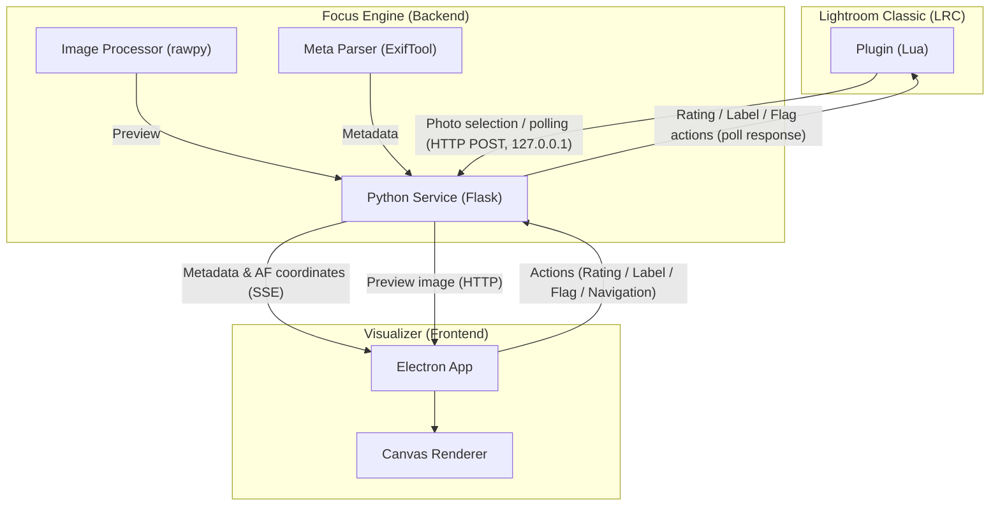

# Focus Visualizer - Knowledge Portal
# Focus Visualizer - ナレッジ・ポータル

This portal connects the concept, specifications, and setup guides of Focus Visualizer.
Focus Visualizer の理念・仕様・導入手順をまとめた入口です。

---

## 🗺️ System Overview / システム俯瞰図

---

## 🌐 Language Selection / 言語選択
The Master Specification is maintained in both English and Japanese.
全体仕様書は、日英両言語で用意しています。

- 🇺🇸 **[English Master Spec (SPECIFICATION_EN.md)](./SPECIFICATION_EN.md)**
- 🇯🇵 **[日本語 全体仕様書 (SPECIFICATION_JP.md)](./SPECIFICATION_JP.md)**

---

## 🗂️ Asset Directory / 資産ディレクトリ

### 1. Vision & Concept / 理念とコンセプト
- [Concept & Philosophy](./FOCUS_VISUALIZER_CONCEPT.md) - Why we build this.

### 2. Viewer / ビューアー
- [UI Specification (Japanese)](./UI_SPECIFICATION.md) - Layout, display logic, and window behavior.

### 3. EXIF Reference / EXIF 資料
- [EXIF Manual (Japanese)](./EXIF_TAGS_GUIDE_JP.md) - User-friendly tag list (Sony α7R V sample).

### 4. Setup & Releases / 導入とリリース
- [Installation Guide (EN)](./INSTALLATION_GUIDE_EN.md) - Setup for English users.
- [インストールガイド (JP)](./INSTALLATION_GUIDE_JP.md) - 日本語環境向けの手順。
- [Releases](https://github.com/muromix/FocusVisualizer/releases/latest) - Downloads and release notes.

---

**Created and Maintained by muromix & Angie**
"Code is the ultimate love letter to our future selves."
「コードは、未来の自分たちへの究極のラブレターよ。」
