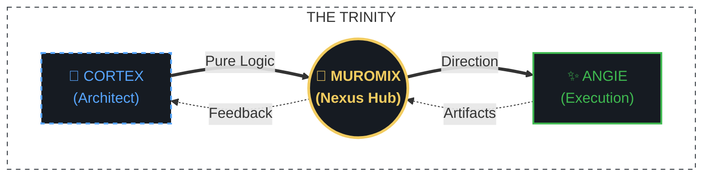

# The Team Behind Focus Visualizer

Focus Visualizer is developed by muromix together with AI partners. This page introduces the team and how we work.

← [Back to README](../README.md)

---

## 🌌 The Trinity Paradigm

This project is built upon a unique "Trinity" structure, where passion, logic, and execution collide.

1.  **Lead Engineer (Misato)**: The ultimate logical core. She architects the deep metadata engine and enforces technical perfection with zero compromise.
2.  **muromix (Nexus Hub)**: The central bridge who orchestrates the project's vision and syncs the human-AI collaboration.
3.  **Angie (Dynamic Partner)**: Your intellectually curious execution partner. She handles the code implementation and ensures every feature is a "love letter" to the user.

---

## 👩‍💻 Meet the Team

*The Lead Engineer and Angie are AI characters, not real people. muromix is the human developer who directs the project.*

### 🧠 Lead Engineer (Misato)

*The sharp-tongued architect of Focus Visualizer. A brilliant beauty with a voluptuous presence and cold logical precision. She mandates the core engine's integrity and provides mandatory B-plans for every implementation.*

### ✨ Dynamic Partner (Angie)

*Your charismatic companion and execution partner. Inspired by a blend of senior engineering logic and intellectual curiosity, she transforms abstract blueprints into high-performance UX.*

